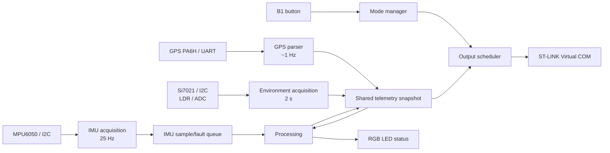

# Phase 1 Architecture Baseline

## Purpose and scope

This document freezes the mandatory application's high-level architecture before implementation. It covers the STM32WL55JC embedded telemetry node running Zephyr OS and the mandatory TEST, NORMAL, and SIMU modes.

The node is a monitoring and telemetry subsystem. It does not control motors or other drone actuators. Wireless fleet communication, LoRaWAN, ground-station connectivity, MAVLink, and other ADVANCED MODE features are outside this baseline.

## Architecture decisions

- Use a layered, multi-rate architecture.
- Sample the MPU6050 at 25 Hz. Each period produces a valid sample event or a fault event.
- Process each IMU event independently of the output schedule.
- Update GPS at approximately 1 Hz and Si7021/LDR data every 2 seconds.
- Schedule output independently for TEST, NORMAL, and SIMU.
- Make `output_thread` the only task that writes to the ST-LINK Virtual COM stream.
- Exchange sensor and processed data through a coherent shared telemetry snapshot.
- Use bounded static queues and synchronization primitives; avoid busy-waiting and unbounded dynamic allocation.
- Keep low-level sensor drivers replaceable and independently testable.

## System data flow



The direction of ownership is strict: acquisition modules publish inputs, processing publishes a coherent processed snapshot, and the output scheduler reads that snapshot. Sensor I/O never occurs while the snapshot lock is held.

## Module boundaries and ownership

| Module | Responsibility | Owner / boundary |
|---|---|---|
| Board and system configuration | Device Tree, Kconfig, boot parameters, enabled peripherals | Application integration |
| Sensor drivers | Register access, bus transactions, raw-data parsing, isolated tests | A supplies; B consumes stable APIs |
| Sensor adapter layer | Convert driver results into application units and validity/error records | B |
| Acquisition manager | Sampling periods, receive handling, timestamps, error propagation | B |
| Shared telemetry | Raw and converted values, UTC, timestamps, validity, errors, processed values | B |
| Processing pipeline | Attitude, local position/velocity, statistics, health | B |
| State detector | IDLE, FLYING, PROBLEM rules and precedence | B |
| Mode manager | B1 debounce and mode transitions | B |
| Output scheduler | Mode timing, formatting dispatch, serial ownership | B |
| SIMU protocol | Fixed-width frame, flags, checksum, host validation hook | B |
| System verification | Integration, fault, timing, simulator, and continuous-run evidence | B with A support |

## Proposed Zephyr task table

| Task | Trigger / rate | Inputs | Outputs |
|---|---|---|---|
| `imu_thread` | 25 Hz deadline | MPU6050 driver | Timestamped valid sample or fault event in the IMU queue |
| `gps_thread` | UART-driven; parse at about 1 Hz | GPS UART/NMEA stream | GPS fix, position, altitude, satellites, UTC, validity flags |
| `environment_thread` | Every 2 s | Si7021 and LDR drivers | Temperature, humidity, light, calibration and validity data |
| `processing_thread` | One event per IMU period | IMU queue and latest sensor snapshot | Attitude, local motion, statistics, health, tracker state |
| `output_thread` | Mode-dependent | Processed telemetry snapshot and mode | TEST, NORMAL, or SIMU text on VCOM |
| `mode_thread` | Debounced B1 event | Button GPIO | Current mode and mode LED indication |

The exact priorities and stack sizes are configuration items to be recorded during Phase 2/3. They must remain bounded and be checked for stack corruption during verification.

## Initialization order

1. Start the Zephyr kernel and establish the application configuration.
2. Resolve and validate board peripherals and Device Tree bindings.
3. Initialize GPIO, B1 input/debounce support, RGB LED outputs, I2C, UART, ADC, and the VCOM path.
4. Initialize synchronization objects, the static IMU queue, the telemetry snapshot, validity/error state, statistics storage, and mode state.
5. Initialize sensor drivers and perform non-blocking readiness checks.
6. Start acquisition, processing, mode, and output tasks with their configured periods.
7. Enter TEST mode and begin the circular transition sequence `TEST -> NORMAL -> SIMU -> TEST`.

Initialization failures must be represented in health/error state and must not prevent the application from continuing far enough to report a valid diagnostic or fallback result.

## Serial output ownership

`output_thread` is the single writer for the ST-LINK Virtual COM stream. Other tasks must publish data or events and must not call `printf()` on this stream.

- TEST: human-readable diagnostic output every 2 seconds.
- NORMAL: human-readable complete report every 5 seconds, with the 30-second statistics block at each completed window.
- SIMU: one complete fixed-width frame every 100 ms at 115200 baud, 8N1, with no banners, logs, or debug text.

This ownership rule is required to keep SIMU output deterministic and parser-safe.

## Resource limits and safety constraints

- Prefer static queues, mutexes, buffers, and state storage.
- Keep critical sections short; never perform sensor I/O while holding the snapshot mutex.
- Use blocking waits, timer deadlines, or events instead of busy-waiting.
- Bound UART/NMEA and SIMU frame buffers to the protocol's known maximum sizes.
- Keep sensor driver code small and explainable at register, bus, and unit-conversion level.
- Do not add wireless or actuator-control paths to the mandatory application.
- Treat missing GPS and temporary sensor failures as data-validity/health events rather than reasons to stop the application.

## Dependency map

```text
Board / Device Tree / Kconfig
        |
        +--> Sensor drivers (A-owned low-level modules)
        |        +--> MPU6050 adapter --> imu_thread --+
        |        +--> GPS adapter ------> gps_thread ----+--> telemetry snapshot
        |        +--> Si7021 adapter ----> environment_thread -+
        |        +--> LDR adapter --------> environment_thread -+
        |
        +--> B1 GPIO --> mode_thread ----------------------+
        +--> RGB GPIO/PWM <---- processing + mode_thread    |
                                                           v
                                             processing_thread
                                                           |
                                             output_thread --> VCOM
```

The sensor-driver layer is replaceable. The shared snapshot, processing, mode, and output layers are the stable application boundary that the rest of the implementation will build on.

## Phase 1 exit criteria

- The architecture diagram, task table, module boundaries, and dependency map are agreed.
- The single-owner VCOM rule is documented.
- The initialization order and resource constraints are recorded.
- The mandatory scope and deferred ADVANCED work are explicit.
- Phase 2 can begin by freezing the sensor APIs, units, timestamps, validity flags, and error model.

